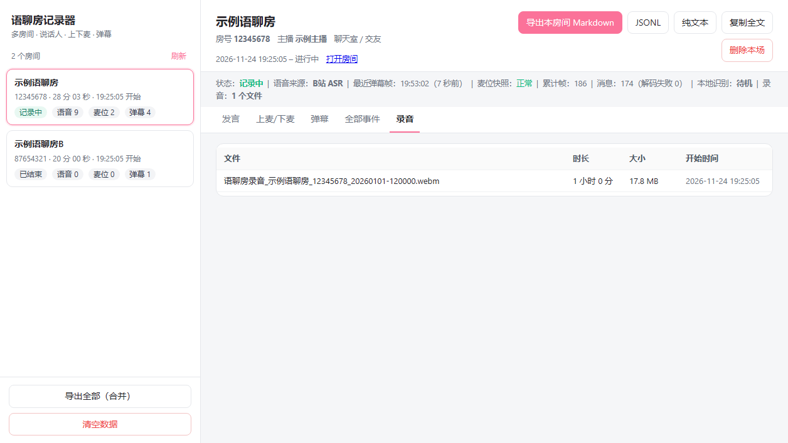

# B 站语聊房记录器（多房间）

> 同时打开多个 B 站语聊房时，把每个房间的**发言（谁在说、说了什么）、上麦/下麦时间点、弹幕、热度**分别、准确地记下来，导出成格式清晰的 Markdown / JSONL / 纯文本；可选保存原始录音。
>
> 纯本地运行：不上传任何记录；B 站没开 ASR 的房间会自动切到本地离线识别（SenseVoice）。


## 功能

- **多房间并行**：每个标签页独立记录，互不串数据；导出时还能生成跨房间的合并时间线。
- **发言**：优先用 B 站语音房下发的 `UNIVERSAL_ASR_TEXT`（自带说话人与毫秒级句时间）；房间没开 ASR 时自动改成本地 SenseVoice 识别。
- **上麦 / 下麦 / 闭麦 / 换麦位**：房间成员快照轮询（含服务端 `join_time`）+ `VOICE_JOIN_STATUS` 事件。
- **弹幕 / 热度 / 在线人数 / 累计看过**：分别记录，不混为一个数字。
- **导出**：单房间 Markdown（六节固定结构）、全部合并 Markdown、JSONL、纯文本、一键复制。
- **可选录音**：WebM/Opus，约 48kbps（1 小时约 20MB），停止后自动保存到下载目录，已补写时长可拖动。

| 本地识别 | 录音 |
| --- | --- |
|  |  |

## 安装

1. 下载本仓库（`Code → Download ZIP`）或 `git clone`；
2. 浏览器打开 `edge://extensions`（Chrome 为 `chrome://extensions`）；
3. 打开「开发人员模式」，点「加载解压缩的扩展」，选择仓库里的 **`extension`** 文件夹；
4. 刷新已经打开的语聊房页面（记录脚本必须在页面加载时注入）。

> 需要 Chrome / Edge 116+（用到 MV3 的 `world: "MAIN"` 内容脚本与离屏文档）。

## 使用

1. 正常打开一个或多个语聊房页面（`live.bilibili.com/房号`）；
2. 点工具栏图标 → 「记录面板」；
3. 左侧选择房间，看实时记录：
   - **发言**：时间、说话人、内容、时长
   - **上麦/下麦**：时间、事件、麦位、在麦时长
   - **弹幕** / **全部事件** / **录音**
4. 右上角导出 Markdown / JSONL / 纯文本，或点「复制全文」直接粘贴；
5. 需要原始录音时，点扩展图标 → 「开始录音」，结束时点「停止并保存录音」。

## 数据来源与准确性

| 内容 | 来源 | 说明 |
| --- | --- | --- |
| 语音转写 + 说话人 | `UNIVERSAL_ASR_TEXT` | B 站语音房自己的实时 ASR，说话人由 B 站给出 |
| 本地识别（无 ASR 房间） | SenseVoice（sherpa-onnx wasm） | 旁听播放器音频，本地推理；说话人按当时麦位推断 |
| 上麦/下麦 | 成员快照 + `VOICE_JOIN_STATUS` | 上麦用服务端 `join_time`；下麦依赖轮询，最多约 4 秒误差 |
| 弹幕 | `DANMU_MSG` | 自动去重 |
| 礼物/SC | `SEND_GIFT` / `SUPER_CHAT_MESSAGE` | 新版 protobuf 礼物事件暂不解析 |
| 热度/在线 | `room_info.online` / `ONLINE_RANK_COUNT` / `WATCHED_CHANGE` | 分开记录 |

## 本地识别（不依赖 B 站 ASR）

- 当房间 `enable_asr === false` 时自动开启；B 站 ASR 正常的房间**不下载模型、不占识别 CPU**；
- 模型：SenseVoice int8（约 228MB），首次使用自动下载（HuggingFace / hf-mirror 自动切换）并缓存；
- 分段：能量 VAD，静音 0.7 秒或说满 12 秒切一段，逐段识别，自带标点；
- 说话人推断：只有 1 人开麦 → 精确归属；多人开麦 → 标 `麦上多人（N）` 并附候选名单；全闭麦 → `麦上（全部闭麦）`；
- 代价：识别时内存约 1GB，最后关闭房间 60 秒后释放。

## 录音

- 只录房间播放的声音（不含麦克风），不需要任何授权；
- 文件：`语聊房录音_房间标题_房号_时间.webm`，WebM/Opus 约 48kbps；
- 每个标签页独立；关闭标签页自动停止并保存；
- 与 B 站 ASR / 本地识别可同时开启。

## 隐私

- 记录存在扩展自己的 IndexedDB（`bili-voice-recorder`），不上传；
- 本地识别的模型从 HuggingFace 下载一次后缓存，音频不离开本机；
- 面板里可「删除本场」「清空数据」。

## 已知限制

- 语音识别质量取决于 B 站 ASR / SenseVoice；多人同时说话、背景音乐、唱歌会明显拉低准确率；
- 本地识别无法区分同时说话的多个麦上用户，只能标「麦上多人」；
- 下麦时间依赖 4 秒轮询，最多约 4 秒误差；
- 未登录时 B 站会把弹幕昵称打码成 `聘***`；
- 录音先缓存在扩展内存里，停止后需要几秒合成；单次上限约 300MB（约 15 小时）。

## 故障排查

| 现象 | 处理 |
| --- | --- |
| 采集帧一直为 0 | 刷新语聊房页面；确认扩展已启用；确认是 `live.bilibili.com/房号` 页面 |
| 麦位快照失败（-352 / -101） | 多为未登录或风控，登录后会自动重试；首屏快照仍可用 |
| 本地识别一直「待机/下载中」 | 首次要下载 228MB 模型，面板有进度；失败会自动切镜像 |
| 面板没有房间 | 先让房间页加载几秒，再点面板「刷新」 |
| 停止录音后下载目录没有文件 | 停止后要等几秒合成；看面板「录音」标签是否已出现 |

## 开发

```
extension/            扩展本体（加载这个目录）
  src/common/         协议解析、归一化、会话聚合、WBI、存储、说话人推断
  src/content/        hook.js（MAIN world，包 WebSocket + 旁听音频）、bridge.js（隔离世界）
  src/offscreen.js    本地识别（SenseVoice + VAD）
  src/ui/             面板与弹窗
  vendor/             brotli wasm、sherpa-onnx wasm 打包产物、fix-webm-duration
tests/                node --test（40 项）
tools/                协议探针、E2E、截图脚本
```

```bash
node --test                                   # 40 项单元测试
node tools/e2e.mjs "12345678,87654321" 45000  # headless Edge 双房间端到端（需本机 Edge）
node tools/e2e-record.mjs 12345678            # 录音冒烟测试
node tools/demo-shots.mjs                     # 用示例数据生成界面截图
```

`extension/vendor/asr-bundle.js` 与 `prebuilt/asr.wasm` 由 [@sherpaw/asr](https://www.npmjs.com/package/@sherpaw/asr) 打包而来（esbuild），仓库里已内置，开箱可用。

## 免责声明

本项目与哔哩哔哩官方无关，仅用于个人记录与学习。请遵守 B 站用户协议与当地法律法规；录制、转写他人语音前请取得在场者同意，不要用于未经授权的传播或商业用途。

## 许可证

- 本项目代码：MIT（见 [LICENSE](LICENSE)）
- 第三方组件与模型：见 [THIRD_PARTY_NOTICES.md](THIRD_PARTY_NOTICES.md)
- SenseVoice 模型不随仓库分发，由扩展在首次使用时下载。

