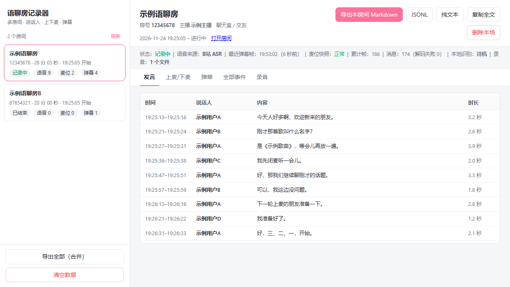

# B 站语聊房记录器

> **不抢麦克风、不偷偷录音，只记谁说了什么。**

你有没有过这种时候：加班、在地铁上、或者只是去做了个饭，回来朋友说“刚才那段你没听到，笑死”。

语聊房没有回放。房间一关，那句话就没了。

这个扩展就是替你留在房间里的那个东西。



它不开你的麦克风、不录你的声音、不上传任何东西，只是在你开着房间的时候，把——

- **谁在说、说了什么、说了多久**
- **谁上麦、谁下麦、在麦多久**
- **弹幕、热度、在线人数**

逐句记下来，带说话人和毫秒级时间。

忙的时候挂着，回来翻一眼就知道自己错过了什么；想找某个话题，导出 Markdown 后 `Ctrl+F` 搜一个词，那天聊过的全都回来了。也可以导出一份给朋友，当那天的“聊天记录”。

> 补充一句准确性：默认**不录音、不做额外转写**——直接接 B 站语音房自己广播的 ASR 文本；只有房间没开 ASR 时才启用本地离线识别。录音是手动可选项，录的是房间播放的声音，不是你的麦克风。

---

## 安装

系统要求：**Edge / Chrome 116 以上**

1. 点上方绿色 **`Code` → `Download ZIP`**，解压到任意目录（不要在压缩包里直接操作）；
   或者 `git clone https://github.com/FlourishingGuardianSpiritofZetuming/bili-room-recorder.git`
2. 打开浏览器扩展页：
   - Edge：地址栏输入 `edge://extensions`
   - Chrome：地址栏输入 `chrome://extensions`
3. 打开右上角的 **「开发人员模式」**；
4. 点 **「加载解压缩的扩展程序」**；
5. 选择解压出来的 **`extension`** 文件夹（是 `extension` 这一层，不是仓库根目录）；
6. 安装完成后，**刷新已经打开的语聊房页面**（记录脚本必须在页面加载时注入）。

## 怎么用

1. 正常打开一个或多个语聊房页面（`live.bilibili.com/房号`）；
2. 点浏览器工具栏上的扩展图标 → **「记录面板」**；
3. 左边选房间，右边看实时记录：**发言 / 上麦下麦 / 弹幕 / 全部事件 / 录音**；
4. 右上角导出：本房间 Markdown、JSONL、纯文本、复制全文；左下角 **「导出全部（合并）」** 可以生成跨房间的合并时间线；
5. 需要原始录音时，点扩展图标 → **「开始录音」**，结束时 **「停止并保存录音」**。

几个房间可以同时开，每个标签页独立记录，互不串数据。

| 发言记录 | 录音 |
| --- | --- |
|  |  |

## 它是怎么记的

- **发言**：B 站语音房本身会把每句话以 ASR 文本广播出来（`UNIVERSAL_ASR_TEXT`，带说话人和毫秒级句时间），扩展直接接这个事件，所以不需要录音再转写；
- **房间没开 ASR**：自动切到本地离线识别（SenseVoice，首次使用下载约 **228MB** 模型，只在这时占资源）；
- **上麦/下麦**：房间成员快照轮询（含服务端 `join_time`）+ `VOICE_JOIN_STATUS` 事件；
- **弹幕 / 热度 / 在线人数**：分别记录，不混成一个数字；
- **录音（可选）**：WebM/Opus，约 48kbps，1 小时约 20MB，停止后自动保存到下载目录。

## 隐私

- 记录只存在浏览器本地的 IndexedDB（`bili-voice-recorder`），**不上传服务器**；
- 本地识别的模型从 HuggingFace 下载一次后缓存，音频不离开本机；
- 录音只录房间播放的声音，不含你的麦克风；
- 面板里可以「删除本场」「清空数据」。

## 已知限制（说在前面）

- 多人同时说话、背景音乐、唱歌会明显拉低识别准确率；
- 下麦时间靠 4 秒轮询，最多约 4 秒误差；上麦时间用服务端 `join_time`，通常精确；
- 未登录时 B 站会把弹幕昵称打码成 `聘***`；
- 本地识别没法区分同时说话的几个人，只能标「麦上多人（N）」；
- 录音先缓存在扩展内存里，停止后需要几秒合成，单次上限约 300MB（约 15 小时）。

## 开发

```
extension/            扩展本体（加载这个目录）
  src/common/         协议解析、事件归一化、会话聚合、存储、说话人推断
  src/content/        hook.js（MAIN world）、bridge.js（隔离世界）
  src/offscreen.js    本地识别（SenseVoice + VAD）
  src/ui/             面板与弹窗
  vendor/             brotli wasm、sherpa-onnx wasm 产物、fix-webm-duration
tests/                node --test（40 项）
tools/                协议探针、E2E、截图脚本
scripts/              重新构建 vendor 依赖
```

```bash
npm test                                      # 40 项单元测试
node tools/e2e.mjs "12345678,87654321" 45000  # headless Edge 双房间端到端（需本机 Edge）
node tools/e2e-record.mjs 12345678            # 录音冒烟测试
node scripts/build-vendor.mjs                 # 从 npm 重新拉取/打包 vendor
```

第三方组件与许可证见 [THIRD_PARTY_NOTICES.md](THIRD_PARTY_NOTICES.md)。

## 免责声明

本项目与哔哩哔哩官方无关，仅用于个人记录与学习，**MIT 协议**。

录制、转写他人语音前请取得在场者同意，不要用于未经授权的传播或商业用途。
